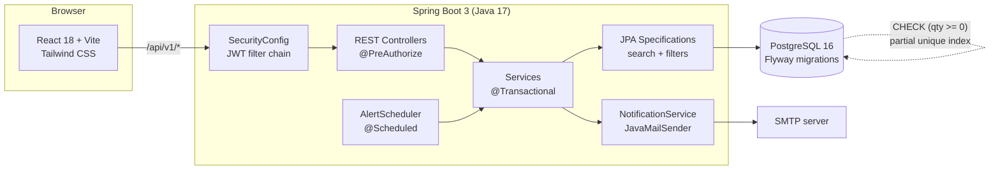

# Mainspring — Inventory & Maintenance Management System

A full-stack **CMMS** (Computerised Maintenance Management System) for a manufacturing plant:
machines, spare-parts inventory, maintenance tickets, role-based access, and an alert engine that
warns you *before* the line stops.

Built with **Java 17 / Spring Boot 3**, **PostgreSQL**, **Spring Security (JWT)** and **React 18**.

> The headline feature is the **transactional stock deduction**: when a technician closes a ticket
> and logs "2 bearings used", those 2 units are deducted inside a single database transaction that
> also locks the row — so inventory can never go negative and the ledger can never disagree with
> the stock balance.

---

## Why this is not a CRUD demo

| Requirement | How it is implemented | Where |
|---|---|---|
| **Role-Based Access Control** | Three roles (`ADMIN`, `TECHNICIAN`, `VIEWER`) enforced with `@PreAuthorize` on every controller, plus a `UserDetailsService` backed by the real `users` table | `backend/.../config/SecurityConfig.java`, `web/*.java` |
| **Automated low-stock & maintenance alerts** | `@Scheduled` scan every 15 min + e-mail digest through `JavaMailSender`; also triggered inline the moment stock changes | `service/AlertService.java`, `job/AlertScheduler.java`, `service/NotificationService.java` |
| **Transactional stock deduction** | `@Transactional` service method → `SELECT … FOR UPDATE` on the part row → quantity check → decrement → immutable ledger row. Any failure rolls the whole thing back | `service/TicketService.java` |
| **Search, pagination & filtering** | Spring Data `Specification` + `Pageable`, server-side, with a stable `PageResponse` envelope | `spec/*Specifications.java`, `web/*Controller.java` |

On top of the four must-haves it also ships:

- **Immutable audit trail** of every write (who / what / when / from which IP).
- **Flyway** versioned schema with `CHECK` constraints that back up the service layer.
- **OpenAPI 3 / Swagger UI** at `/swagger-ui.html` with a bearer-token scheme.
- **Docker Compose** — `docker compose up --build` and the whole stack is running.
- **Integration tests** that prove the transactional and RBAC claims rather than asserting trivialities.
- **Demo data seeder** so the app is populated and explorable on first boot.

---

## Architecture



**Layer rules that are actually enforced**

- Controllers never return entities — only DTOs — so lazy relations can never leak into JSON
  (`spring.jpa.open-in-view=false` makes this a hard failure rather than a silent N+1).
- Every write goes through a `@Transactional` service method; `@PreAuthorize` sits on the controller.
- Hibernate runs with `ddl-auto=validate`; **Flyway owns the schema**.

---

## Quick start

### Option A — Docker (recommended)

```bash
git clone https://github.com/Zer0ne1en/Full-Stack-Inventory-Maintenance-Management-System.git
cd Full-Stack-Inventory-Maintenance-Management-System
cp .env.example .env            # optional — defaults work out of the box
docker compose up --build
```

| Service | URL |
|---|---|
| Web UI | <http://localhost:3000> |
| REST API | <http://localhost:8080/api/v1> |
| Swagger UI | <http://localhost:8080/swagger-ui.html> |
| Actuator health | <http://localhost:8080/actuator/health> |
| PostgreSQL | `localhost:5432` (db `cmms`, user `cmms`, password `cmms`) |

### Option B — run the backend locally

Requires JDK 17+, Maven 3.9+ and a PostgreSQL 16 instance.

```bash
cd backend
createdb cmms                      # or use the Docker DB: docker compose up -d db
export DB_HOST=localhost DB_USER=cmms DB_PASSWORD=cmms DB_NAME=cmms
export JWT_SECRET="$(openssl rand -base64 48)"
mvn spring-boot:run
```

The API starts on `:8080`, runs the Flyway migrations, seeds the demo plant, and begins the alert
scan on a 15-minute cron. Swagger is at `/swagger-ui.html`.

### Option C — frontend against the API

```bash
cd frontend
npm install
API_PROXY=http://localhost:8080 npm run dev     # Vite on :5173, proxies /api
```

### Option D — no JDK available? Use the API stub

`tools/mock-api/server.mjs` is a dependency-free Node server that implements the **same REST
contract** as the Spring Boot API. It exists purely so the UI can be developed and demoed on a
machine without Java.

```bash
node tools/mock-api/server.mjs &     # :8080
cd frontend && npm run dev           # :5173
```

It is explicitly **not** the product — delete it once the Spring Boot API is running.

---

## Demo accounts

| Role | Email | Password | Can do |
|---|---|---|---|
| Admin | `admin@mainspring.dev` | `Admin@123` | Everything: catalogue, users, assignments, scans |
| Technician | `tech@mainspring.dev` | `Tech@123` | Work own tickets, log parts, close jobs |
| Viewer / Auditor | `viewer@mainspring.dev` | `Viewer@123` | Read dashboards, stock levels and the audit trail |

Seeded by `DemoDataSeeder` on first boot against an empty database
(`app.seed-demo-data=false` to disable).

---

## The four must-haves, in detail

### 1. Role-Based Access Control

Roles are a Java enum — a typo cannot silently grant access — and are checked at two levels:

```java
// SecurityConfig — the filter chain and the UserDetailsService wiring
@Bean
public UserDetailsService userDetailsService(UserRepository repo) {
    return email -> repo.findByEmail(email).map(SecurityUser::new)
            .orElseThrow(() -> new UsernameNotFoundException("No account for " + email));
}

// TicketController — policy lives next to the code it protects
@PostMapping("/{id}/close")
@PreAuthorize("hasAnyRole('ADMIN','TECHNICIAN')")
public TicketResponse close(...) { ... }
```

Beyond the role check, `TicketService` enforces **object-level ownership**: a technician may only
close a ticket assigned to them. `Viewer` can read `/api/v1/audit` but gets `403` on `/api/v1/users`.

### 2. Automated low-stock & maintenance alerts

Two triggers feed the same de-duplicated alert feed:

1. **Reactive** — `AlertService.evaluateLowStock()` is called from every code path that changes a
   part's quantity, so a threshold breach surfaces immediately rather than on the next cron tick.
2. **Scheduled** — `AlertScheduler` runs `app.alerts.cron` (every 15 min by default) and sweeps for
   low stock, machines reaching their service interval, and tickets that have sat too long.

Alerts are de-duplicated per `(type, referenceId)` while unread, both in the service
(`existsByTypeAndReferenceIdAndReadAtIsNull`) and in the database with a **partial unique index**:

```sql
CREATE UNIQUE INDEX uq_alert_unread ON alerts (alert_type, reference_id) WHERE read_at IS NULL;
```

E-mail is a single MIME digest per scan, sent through `JavaMailSender`, and is **best-effort**: a
misconfigured SMTP host logs a warning and never breaks the transaction that raised the alert.
Set `ALERT_EMAIL_ENABLED=true` plus `SMTP_HOST` to turn delivery on. Admins can also force a scan
from the UI (**Run alert scan**) or `POST /api/v1/alerts/scan`.

### 3. Transactional stock deduction

`TicketService.consumeStock` is the heart of the system:

```java
private List<TicketPartUsage> consumeStock(MaintenanceTicket ticket,
                                           List<UsageItem> items, User actor) {
    // 1. Merge duplicate lines: 2 + 3 of the same SKU becomes one 5-unit deduction.
    // 2. Lock the row:  SELECT ... FOR UPDATE  — concurrent closes serialise here.
    SparePart part = partRepository.findByIdForUpdate(partId).orElseThrow(...);

    // 3. Refuse before writing anything.
    if (part.getQuantityOnHand() < requested) {
        throw new InsufficientStockException(part.getSku(), part.getName(), requested, available);
    }

    // 4. Decrement and append to the immutable ledger.
    part.setQuantityOnHand(available - requested);
    TicketPartUsage usage = new TicketPartUsage();   // unit cost captured now
    ...
}
```

Because the whole method runs inside the caller's `@Transactional` boundary, a failure on the
**third** part of a three-part request leaves the first two untouched: no stock change, no ledger
row, ticket still open. The API answers `409 INSUFFICIENT_STOCK`.

The guarantee is triple-locked:

| Layer | Mechanism |
|---|---|
| Service | explicit `available < requested` check |
| Concurrency | `@Lock(LockModeType.PESSIMISTIC_WRITE)` → `SELECT … FOR UPDATE` |
| Database | `CHECK (quantity_on_hand >= 0)` and `CHECK (quantity_used > 0)` |

Closing a ticket also reschedules the machine's next service from `serviceIntervalDays` and returns
the machine to `OPERATIONAL` once its last open ticket is gone.

### 4. Search, pagination & filtering

Everything is resolved by the API — the client never slices an array.

```
GET /api/v1/tickets?status=OPEN&priority=HIGH&machineId=2&q=bearing&page=0&size=10&sort=openedAt,desc
GET /api/v1/parts?q=BRG&category=Bearings&lowStock=true&page=0&size=25
GET /api/v1/machines?q=press&status=UNDER_MAINTENANCE
```

Predicates are composed with `Specification<T>` (`TicketSpecifications`, `PartSpecifications`,
`MachineSpecifications`, `UserSpecifications`) so filters combine freely without query-string
concatenation. Results use a flat envelope so the frontend contract never moves with a framework
upgrade:

```json
{ "content": [...], "page": 0, "size": 10, "totalElements": 42, "totalPages": 5,
  "last": false, "first": true }
```

Sorting is constrained to real entity properties — a bogus `sort=` field returns a clean
`400 INVALID_SORT` instead of a 500.

---

## API reference

All routes are prefixed with `/api/v1`. Authenticate with `POST /auth/login` and send
`Authorization: Bearer <token>`.

| Method | Path | Role | Purpose |
|---|---|---|---|
| POST | `/auth/login` | public | Exchange credentials for a JWT |
| POST | `/auth/register` | public | Self-register (always `VIEWER`) |
| GET | `/auth/me` | any | Current identity |
| POST | `/auth/change-password` | any | Requires current password |
| GET | `/dashboard` | any | KPIs, trend, low stock, upcoming service, activity |
| GET/POST | `/machines` | any / ADMIN | List (paginated, filterable) / create |
| GET/PUT/DELETE | `/machines/{id}` | any / ADMIN | Detail / update / delete (409 if history) |
| GET | `/machines/{id}/tickets` | any | Tickets raised against a machine |
| GET/POST | `/parts` | any / ADMIN | Search by SKU/name, filter by category & low stock |
| GET/PUT/DELETE | `/parts/{id}` | any / ADMIN | Detail / update / delete (409 if used) |
| POST | `/parts/{id}/adjust` | ADMIN | Manual stock correction, never negative |
| GET/POST | `/tickets` | any / ADMIN | List with status, priority, machine, technician, text |
| GET/PATCH | `/tickets/{id}` | any / ADMIN | Detail / update |
| POST | `/tickets/{id}/assign` | ADMIN | Assign a technician |
| POST | `/tickets/{id}/start` | TECHNICIAN, ADMIN | `OPEN → IN_PROGRESS` |
| POST | `/tickets/{id}/parts` | TECHNICIAN, ADMIN | Deduct stock onto the ledger |
| POST | `/tickets/{id}/close` | TECHNICIAN, ADMIN | Deduct parts **and** close, atomically |
| POST | `/tickets/{id}/reopen` | ADMIN | Reopen a closed ticket |
| GET | `/alerts` | any | Feed, `unreadOnly` / `type` filters |
| POST | `/alerts/scan` | ADMIN | Force an alert sweep |
| PATCH | `/alerts/{id}/read` | any | Acknowledge one |
| POST | `/alerts/read-all` | any | Acknowledge everything |
| GET | `/users` | ADMIN | Directory, paginated |
| GET | `/users/technicians` | TECHNICIAN, ADMIN | Assignable roster |
| POST/PATCH | `/users[/{id}]` | ADMIN | Create / change role, status, password |
| GET | `/audit` | ADMIN, VIEWER | Append-only audit trail |

Errors always use one shape:

```json
{ "timestamp": "…", "status": 409, "error": "Conflict", "code": "INSUFFICIENT_STOCK",
  "message": "Insufficient stock for … (BRG-6205): requested 10, only 9 available",
  "path": "/api/v1/tickets/42/close", "fieldErrors": null }
```

---

## Project structure

```
.
├── backend/                          Spring Boot 3.3 · Java 17 · Maven
│   ├── pom.xml
│   ├── Dockerfile
│   └── src/main/java/com/mainspring/cmms/
│       ├── CmmsApplication.java
│       ├── config/                   SecurityConfig, JwtProperties, AlertProperties, OpenApiConfig
│       ├── security/                 JwtService, JwtAuthFilter, SecurityUser, REST error handlers
│       ├── domain/                   User, Machine, SparePart, MaintenanceTicket,
│       │                             TicketPartUsage, Alert, AuditLog + enums
│       ├── repository/               Spring Data JPA (+ pessimistic-lock query)
│       ├── spec/                     JPA Specifications for search & filtering
│       ├── service/                  TicketService, PartService, AlertService, AuditService, …
│       ├── job/                      AlertScheduler
│       ├── bootstrap/                DemoDataSeeder
│       ├── web/                      Controllers + DTO records
│       └── exception/                ApiException hierarchy + GlobalExceptionHandler
│   └── src/main/resources/
│       ├── application.yml           (+ -dev, test profiles)
│       └── db/migration/V1__init_schema.sql
│
├── frontend/                         React 18 · Vite · Tailwind CSS
│   ├── src/
│   │   ├── components/               layout shell, UI primitives, icon set
│   │   ├── context/                  AuthContext, ToastContext
│   │   ├── hooks/                    useAsync, useDebouncedValue
│   │   ├── lib/                      api client, formatters
│   │   └── pages/                    Dashboard, Machines, Parts, Tickets, Alerts, …
│   ├── nginx.conf
│   └── Dockerfile
│
├── tools/mock-api/server.mjs         Dev-only API stub (same contract, no JDK needed)
├── docker-compose.yml
├── .env.example
└── README.md
```

---

## Testing

```bash
cd backend && mvn test
```

| Test | What it proves |
|---|---|
| `TicketStockTransactionIntegrationTest` | Closing a ticket deducts exactly the logged quantity and writes the ledger row; duplicate lines merge; **a short part aborts the whole transaction** (stock, status and ledger all unchanged); a technician cannot close someone else's ticket; closing the last ticket returns the machine to `OPERATIONAL` |
| `AuthAndRbacIntegrationTest` | Login issues a JWT; wrong password → JSON 401; protected routes reject anonymous calls; a viewer can read but gets 403 on writes; a tampered token is rejected |
| `TicketSearchPaginationIntegrationTest` | Server-side pagination reports correct totals/pages; status, priority and free-text filters each narrow correctly |
| `JwtServiceTest` | Tokens round-trip subject/role and reject a foreign signing key |

Tests run against in-memory **H2 in PostgreSQL compatibility mode** (`application-test.yml`,
Flyway disabled) so `mvn test` needs no Docker. The production schema is still owned by Flyway.

Frontend smoke test (mounts every route in jsdom against the mock API):

```bash
node tools/mock-api/server.mjs &
node frontend/scripts/smoke.mjs
```

---

## Configuration

| Variable | Default | Purpose |
|---|---|---|
| `DB_HOST` / `DB_PORT` / `DB_NAME` / `DB_USER` / `DB_PASSWORD` | localhost / 5432 / cmms / cmms / cmms | Datasource |
| `JWT_SECRET` | dev placeholder | HMAC secret — **override everywhere real** |
| `JWT_EXPIRATION_MINUTES` | `720` | Token lifetime |
| `CORS_ORIGINS` | `http://localhost:5173,…:3000` | Allowed UI origins |
| `ALERT_CRON` | `0 */15 * * * *` | Alert sweep schedule |
| `ALERT_OVERDUE_HOURS` | `72` | When a non-closed ticket becomes "stale" |
| `ALERT_SERVICE_WINDOW_DAYS` | `14` | How far ahead service-due alerts fire |
| `ALERT_EMAIL_ENABLED` | `false` | Master switch for `JavaMailSender` |
| `ALERT_EMAIL_RECIPIENT` | — | Digest recipient |
| `SMTP_HOST` / `SMTP_PORT` / `SMTP_USER` / `SMTP_PASS` | empty | Mail transport |
| `SEED_DEMO_DATA` | `true` | Seed the demo plant on an empty DB |

---

## Design notes

- **Why pessimistic locking rather than `@Version`?** Two technicians closing tickets against the
  same low-stock part must serialise, not one-succeeds-one-retries. `SELECT … FOR UPDATE` gives the
  second transaction the *post-decrement* value, so the check is honest. Optimistic locking would
  force a retry loop the user can't drive.
- **Why a separate `ticket_part_usages` table?** Because "stock on hand" is a point-in-time balance
  and "what did we use on this repair" is history. Conflating them makes both unreliable. The usage
  row snapshots `unit_cost` so a price change never rewrites an old repair's cost.
- **Why records for DTOs?** Immutable, allocation-cheap, and they keep request/response shapes out of
  the entity graph — which is also what stops lazy-loading exceptions at the serialisation boundary.
- **Why a `PageResponse` instead of Spring's `Page`?** Spring's serialisation of `Page` has changed
  shape across versions. A five-field envelope is a contract the frontend can rely on.

---

## License

MIT — use it, break it, put it on your CV.
